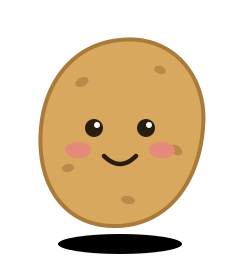

Je m'appelle Valentin. Je fais des jeux sur Roblox, en Lua, et je vibe code le reste : je décris ce que je veux, j'itère et j'avance vite.

J'ai aussi mon site web : [valentinstark.com](https://valentinstark.com)

**Roblox**

-2C2D72?style=for-the-badge&logo=lua&logoColor=white)

**Outils IA & éditeurs**

**Mon site web**

**Versioning**

 

